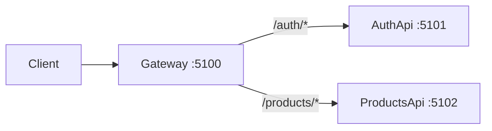

Lessons [Authentication](/learn/dotnet-api/05-auth/01-authentication) and [Authorization](/learn/dotnet-api/05-auth/02-authorization) built a **monolith**: one host issues JWTs, embeds `permission` claims, and enforces policies.

This lesson splits that into a **minimal microservice demo** (MyApp branch `auth-2`):

| Host | Port | Job |
| --- | --- | --- |
| `MyApp.Gateway` | `:5100` | YARP reverse proxy — forwards `Authorization` |
| `MyApp.Api` (Auth) | `:5101` | Issues tokens, IAM admin, invoices / auth demos |
| `MyApp.ProductsApi` | `:5102` | Product CRUD with the **same** permission policies |

Claim shape stays exactly what lesson 02 taught:

- claim type `permission`
- values / policy names `Permissions.Products.Create`, …

We do **not** copy Hospital’s DB permission re-check onto every service. Downstream hosts trust the validated JWT claims (short-lived access tokens + `PermissionVersion` bump on the issuer).



---

## Why a shared auth library?

If each service pastes its own `AddJwtBearer` + `PermissionAuthorizationHandler`, they drift. Hospital solves this with `AddHospitalAuth` in a building-block project. MyApp mirrors that:

```text
src/Shared/MyApp.Auth.Jwt/
  AddMyAppAuth(configuration)      → JWT HS256 + AddMyAppAuthorization
  Permissions / AuthClaimTypes
  PermissionRequirement + handler
  PermissionPolicyProvider
```

Every API host that must accept end-user JWTs calls **one** extension method.

<Guide title="Shared AddMyAppAuth" numbered headingLevel={2} stepHeadingLevel={3}>

<GuideStep title="1. Jwt options + bearer validation">

```csharp title="src/Shared/MyApp.Auth.Jwt/AuthServiceCollectionExtensions.cs" showLineNumbers {8-12,20-28}
public static IServiceCollection AddMyAppAuth(
    this IServiceCollection services,
    IConfiguration configuration)
{
    services.Configure<JwtOptions>(configuration.GetSection(JwtOptions.Section));

    services.AddAuthentication(JwtBearerDefaults.AuthenticationScheme)
        .AddJwtBearer(JwtBearerDefaults.AuthenticationScheme, opts =>
        {
            var jwt = configuration.GetSection(JwtOptions.Section).Get<JwtOptions>()
                      ?? throw new InvalidOperationException("Jwt config section missing.");
            // Validate issuer / audience / HS256 signing key
            // MapInboundClaims = false → raw "sub", "permission", "token_version"
            opts.MapInboundClaims = false;
            opts.TokenValidationParameters = /* ... */;
        });

    services.AddMyAppAuthorization();
    return services;
}
```

**Why the same secret everywhere?** Symmetric HS256 means AuthApi **signs** with `Jwt:Secret` and ProductsApi **validates** with the identical value. Generate once (`openssl rand -base64 32`) and inject via env / secret store — never commit a production key.

</GuideStep>

<GuideStep title="2. Claim-only permission authorization">

```csharp title="src/Shared/MyApp.Auth.Jwt/AuthServiceCollectionExtensions.cs" showLineNumbers {1-8}
public static IServiceCollection AddMyAppAuthorization(this IServiceCollection services)
{
    services.AddAuthorization();
    services.AddSingleton<IAuthorizationPolicyProvider, PermissionPolicyProvider>();
    services.AddSingleton<IAuthorizationHandler, PermissionAuthorizationHandler>();
    return services;
}
```

`PermissionAuthorizationHandler` only reads `AuthClaimTypes.Permission` on `context.User` — same Level 1/3 pattern from lesson 02. No `DbUserPermissionChecker` on ProductsApi (that host has no IAM database).

</GuideStep>

<GuideStep title="3. One-liner on each API host">

```csharp title="src/Services/MyApp.ProductsApi/Program.cs" showLineNumbers {1-3}
builder.Services.AddMyAppAuth(builder.Configuration);
// then UseAuthentication / UseAuthorization and Map* endpoints
```

AuthApi does the same, then adds issuer-only extras:

```csharp title="src/Services/MyApp.Api/Presentation/DependencyInjection.cs" showLineNumbers {1-6}
services.AddMyAppAuth(configuration);
services.ConfigureOptions<ConfigureJwtBearer>(); // ban + token_version DB check
// WorkingHours / EnhancedSecurity / ResourcePermission handlers stay on AuthApi
```

</GuideStep>

</Guide>

---

## YARP gateway (pass-through)

The gateway is intentionally dumb: **no JWT validation**, no permission logic. It terminates the public port and proxies paths.

<Guide title="Minimal YARP host" numbered headingLevel={2} stepHeadingLevel={3}>

<GuideStep title="1. Project + package">

```xml title="src/Services/MyApp.Gateway/MyApp.Gateway.csproj"
<PackageReference Include="Yarp.ReverseProxy" />
```

</GuideStep>

<GuideStep title="2. Program.cs">

```csharp title="src/Services/MyApp.Gateway/Program.cs" showLineNumbers {1-10}
var builder = WebApplication.CreateBuilder(args);

builder.Services.AddReverseProxy()
    .LoadFromConfig(builder.Configuration.GetSection("ReverseProxy"));

var app = builder.Build();
app.MapGet("/health", () => Results.Ok(new { status = "ok", service = "gateway" }));
app.MapReverseProxy();
app.Run();
```

YARP forwards the `Authorization` header by default. Each downstream host still runs `UseAuthentication` / `UseAuthorization`.

</GuideStep>

<GuideStep title="3. Routes">

```json title="src/Services/MyApp.Gateway/appsettings.json" showLineNumbers {1-24}
{
  "ReverseProxy": {
    "Routes": {
      "auth-route": {
        "ClusterId": "auth",
        "Match": { "Path": "/auth/{**catch-all}" }
      },
      "products-route": {
        "ClusterId": "products",
        "Match": { "Path": "/products/{**catch-all}" }
      }
    },
    "Clusters": {
      "auth": {
        "Destinations": { "d1": { "Address": "http://localhost:5101/" } }
      },
      "products": {
        "Destinations": { "d1": { "Address": "http://localhost:5102/" } }
      }
    }
  }
}
```

</GuideStep>

</Guide>

---

## ProductsApi — permission-gated slice

ProductsApi is a **thin** host: in-memory store + the same `Permissions.Products.*` policies. It proves a second process can authorize without the IAM DbContext.

```csharp title="src/Services/MyApp.ProductsApi/Program.cs" showLineNumbers {1-8}
app.MapPost("/products", (CreateProductBody body) => { /* ... */ })
    .RequireAuthorization(Permissions.Products.Create);

app.MapPut("/products/{id:guid}", (Guid id, CreateProductBody body) => { /* ... */ })
    .RequireAuthorization(Permissions.Products.Edit);

app.MapDelete("/products/{id:guid}", (Guid id) => { /* ... */ })
    .RequireAuthorization(Permissions.Products.Delete);
```

`PermissionPolicyProvider` turns those strings into policies on demand — no `AddPolicy` loop in `Program.cs`.

<Callout variant="warning" title="Two product stacks in the demo">
AuthApi still keeps its full Products feature slice so monolith integration tests on the issuer keep working. Through the **gateway**, `/products` hits ProductsApi. Call AuthApi directly on `:5101` only when debugging IAM.
</Callout>

---

## Try it

1. Align `Jwt:Secret` / Issuer / Audience on AuthApi (`.env`) and ProductsApi (`appsettings.json`).
2. Run AuthApi `:5101`, ProductsApi `:5102`, Gateway `:5100`.
3. Login via gateway:

```bash
curl -s http://localhost:5100/auth/login \
  -H 'Content-Type: application/json' \
  -d '{"email":"admin@example.com","password":"..."}'
```

4. Create a product with the access token:

```bash
curl -s http://localhost:5100/products \
  -H "Authorization: Bearer $TOKEN" \
  -H 'Content-Type: application/json' \
  -d '{"name":"Widget","category":"Gadgets","price":9.99,"stock":3}'
```

Admin JWT includes `Permissions.Products.Create` → **201**. A plain User JWT (View only) → **403**.

---

## What this lesson deliberately skips

| Skip | Why |
| --- | --- |
| DB permission re-check on every host | Needs shared IAM DB; claim-only matches the Learn 02 story |
| RS256 / JWKS | Next step when many independent teams own secrets |
| OAuth / BFF / M2M client-credentials | Out of scope for this demo |
| Gateway validates JWT | Optional hardening; validation at each API is enough for the teaching model |

MyApp pointer doc: `MyApp/backend/docs/auth/gateway-jwt.md` (branch `auth-2`).

## References

- [Authentication](/learn/dotnet-api/05-auth/01-authentication) — issue HS256 JWTs, `token_version`
- [Authorization](/learn/dotnet-api/05-auth/02-authorization) — `permission` claims, `PermissionPolicyProvider`, resource auth
- Hospital reference: `AddHospitalAuth` in `arch.test` (shared registration shape; richer DB checkers)
